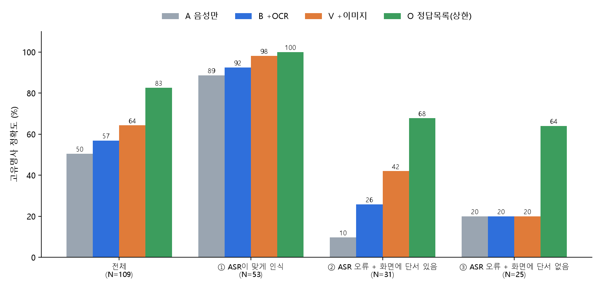

# 화면 정보는 e스포츠 음성번역의 고유명사 오역을 얼마나 줄이는가
**LoL Worlds 2026 한국어 중계 → 영어 자막 번역 미니 실험**

> 실시간 e스포츠 음성번역에서는 선수명, 팀명, 챔피언·스킬명 같은 고유명사가 음성인식 단계부터 잘못 들리기 쉽습니다.
> 그런데 중계 화면에는 스코어보드, 선수 배너, 밴픽 화면처럼 정답 단서가 떠 있습니다.
> 이 실험은 **같은 번역 모델에 입력 정보만 바꿔서**, 화면 정보(OCR 텍스트 / 이미지 직접 입력)가 고유명사 오역을 얼마나, 어떤 경우에 줄이는지 측정합니다.

## TL;DR
- Worlds 2026 한국어 중계(8강·4강 6개 매치) **30개 구간(각 10초)**, 해설이 언급한 고유명사 **109개**를 직접 라벨링했습니다.
- 음성만 번역할 때 고유명사 정확도 **50.5%** → OCR 텍스트를 추가하면 **56.9%**, 화면 이미지를 직접 넣으면 **64.2%** (정답 목록을 준 상한선은 82.6%)
- 효과는 **음성인식이 틀렸고 화면에 단서가 있는 경우(②)**에 집중됐습니다: **9.7% → 25.8%(OCR) → 41.9%(이미지)**. 화면에 단서가 없는 경우(③)는 세 조건 모두 20.0%로 변화가 없었습니다.
- 효과는 **선수명**에서 컸고(38.6% → 68.2%), 챔피언·스킬명은 A·B·V가 같았습니다. 인게임 화면에 챔피언 이름이 글자로 거의 나오지 않기 때문으로 보입니다.
- 이미지 입력이 OCR보다 나았던 이유 중 하나는 OCR이 화면 속 이름의 **36.2%**만 읽었기 때문입니다(`Melko`, `Tlan`, `JackoyLovu`). 반대로 화면 정보 때문에 맞던 이름을 다른 선수 이름으로 바꾼 사례도 있었습니다(아래 대표 사례).



## 실험 설계
```
중계 VOD 구간 ─┬─ 오디오 ─ Whisper(large-v3-turbo) ─ ASR 텍스트 ─┐
               └─ 프레임 3장 ─┬─ EasyOCR ─ 화면 텍스트 ───────────┤
                              └──────────── 이미지 ────────────────┼─ 번역 LLM (Gemini 3.1 Flash-Lite, 4조건 동일)
                           정답 고유명사 목록 (상한선용) ──────────┘
```

| 조건 | 번역 모델에 주는 입력 |
|---|---|
| **A** 음성만 | ASR 텍스트 |
| **B** +OCR | ASR 텍스트 + 화면 OCR 텍스트 |
| **V** +이미지 | ASR 텍스트 + 화면 캡처 이미지 |
| **O** 상한선 | ASR 텍스트 + 정답 고유명사 목록 |

- **같은 모델**(Gemini 3.1 Flash-Lite, temperature 0)로 네 조건을 모두 실행해 입력 정보 외의 변수를 통제했습니다.
- **데이터**: 치지직 Worlds 2026 한국어 중계 VOD 6개 매치(TES-IG, GEN-LYON, DK-BLG, T1-KC, IG-GEN, BLG-T1)에서 10초 구간 30개. 화면 구성은 인게임 16 / 밴픽 9 / 분석 데스크 5개 구간입니다.
- **라벨**: 해설이 실제로 말한 고유명사만 적었습니다(선수 44, 챔피언 39, 팀 16, 스킬 10). 해설이 줄여 부른 이름(예: "제키", "칼나타")은 들린 그대로 적고, 정답 영어 표기는 공식 ID·공식 명칭으로 정했습니다.
- **평가 지표**: 고유명사 정확도. 해설이 말한 고유명사가 번역문에 허용 표기(예: `Faker`, `Kalista`)로 들어갔는지 봅니다. BLEU 같은 문장 단위 지표는 이름 하나가 틀려도 점수 변화가 작아서 따로 측정했습니다.
- **케이스 분류**: ① ASR이 맞게 인식 / ② ASR 오류 + 화면에 단서 있음 / ③ ASR 오류 + 화면에 단서 없음
- **통계**: 구간 단위 부트스트랩 95% 신뢰구간, 같은 고유명사에 대한 조건 간 McNemar 정확검정

## 결과

### 조건별 고유명사 정확도 (N=109)

| 조건 | 정확도 | 95% CI | 평균 지연 |
|---|---|---|---|
| A 음성만 | 50.5% | 38.9% ~ 62.5% | 1.7s |
| B +OCR | 56.9% | 44.9% ~ 69.0% | 1.8s |
| V +이미지 | 64.2% | 53.4% ~ 74.6% | 3.9s |
| O 정답목록(상한) | 82.6% | 74.6% ~ 90.1% | 1.6s |

### 케이스별 정확도

| 케이스 | N | A 음성만 | B +OCR | V +이미지 | O 정답목록(상한) |
|---|---|---|---|---|---|
| ① ASR이 맞게 인식 | 53 | 88.7% | 92.5% | 98.1% | 100.0% |
| ② ASR 오류 + 화면에 단서 있음 | 31 | **9.7%** | **25.8%** | **41.9%** | 67.7% |
| ③ ASR 오류 + 화면에 단서 없음 | 25 | 20.0% | 20.0% | 20.0% | 64.0% |

### 짝지은 비교 (McNemar 정확검정)

| 비교 | 고쳐짐(오답→정답) | 망가짐(정답→오답) | p값 |
|---|---|---|---|
| A → B | 8 | 1 | 0.039 |
| A → V | 17 | 2 | 0.001 |
| B → V | 11 | 3 | 0.057 |
| A → O | 35 | 0 | <0.001 |

### 유형별·화면별 정확도

| 구분 | N | A | B | V | O |
|---|---|---|---|---|---|
| 선수 | 44 | 38.6% | 47.7% | 68.2% | 79.5% |
| 팀 | 16 | 56.2% | 75.0% | 68.8% | 93.8% |
| 챔피언 | 39 | 66.7% | 66.7% | 66.7% | 82.1% |
| 스킬 | 10 | 30.0% | 30.0% | 30.0% | 80.0% |
| 인게임 화면 | 61 | 34.4% | 41.0% | 49.2% | 75.4% |
| 밴픽 화면 | 31 | 74.2% | 77.4% | 83.9% | 93.5% |
| 분석 데스크 | 17 | 64.7% | 76.5% | 82.4% | 88.2% |

- 화면에 보이는 고유명사 58개 중 OCR이 읽어낸 비율은 **36.2%**입니다.
- 정답 목록을 준 O 조건도 82.6%에 그쳤습니다. 틀린 19개는 모두 A·B·V에서도 틀렸는데, ASR 텍스트에서 이름이 아예 빠지면 정답 목록이 있어도 번역 모델이 끼워 넣지 않는 경우로 보입니다.

### 오류 유형
틀린 159건(조건별 고유명사 오답)에 오류 원인을 하나씩 직접 붙였습니다.

| 오류 유형 | A 음성만 | B +OCR | V +이미지 | O 정답목록 |
|---|---|---|---|---|
| ASR 오인식 | 48 | 0 | 0 | 0 |
| OCR 오류 | 0 | **24** | 0 | 0 |
| 화면 단서 없음 | 0 | 20 | 19 | 0 |
| 단서 무시 | 2 | 3 | **13** | 19 |
| 과잉 삽입 | 0 | 0 | **7** | 0 |
| 철자 오류 | 3 | 0 | 0 | 0 |
| 사전 지식 대체 | 1 | 0 | 0 | 0 |
| **합계** | 54 | 47 | 39 | 19 |

- **OCR 조건(B)의 병목은 OCR 자체**였습니다. B 오답 47건 중 24건(51%)은 화면에 이름이 있었는데 OCR이 못 읽거나 깨지게 읽은 경우입니다. OCR 정확도를 올리거나 선수 명단으로 보정하면 B가 개선될 여지가 큽니다.
- **이미지 조건(V)은 정보를 보고도 쓰지 못하는 문제**가 남았습니다. V 오답 39건 중 13건은 화면에 이름이 보였는데 반영하지 않았고(단서 무시), 7건은 화면에 있는 다른 이름을 끼워 넣었습니다(과잉 삽입).
- 사전 지식 대체: 음성인식이 신인 선수 "예후"를 정확히 들었는데도, 번역 모델이 이를 유명 선수 이름(*BuLLDoG*)으로 바꾼 사례가 1건 있었습니다.

### 대표 사례
| 구간 | 해설 ASR (요약) | 화면 OCR | A 음성만 | B +OCR | V +이미지 |
|---|---|---|---|---|---|
| s02 인게임 | "게조우가 … 칼라타를 … permiko가 피했죠" | `Zhuu`, `Melko`, `JackoyLovu` | **Kingen** has used **K'Sante** … **Permiko** dodged it | **Kingen** … **K'Sante** … dodged by **Creme** | ✅ **Zhuo** … **Kalista** … ✅ **Meiko** dodged it |
| s10 인게임 | "항상 **도플란**은 마음의 준비를" | `Berserker`, `Inspired`, `Canyon` | **Delight** must always be prepared | ✅ **Dhokla** always needs to be prepared | ✅ **Dhokla** always needs to be prepared |
| s06 밴픽 (반례) | "**켄현** 역시 키아나를 정말 잘 쓸 수 있는" | (선수명 없음) | ✅ **Canyon** is also a player … | ❌ **Kingen** is also a player … | ❌ **Kiin** is also a player … |
| s17 인게임 (반례) | "**런블**를 잡아야 해요 … **프린즈**가 잡아냅니다" | `TI Fakeris on a killing spree!` | ✅ **Rumble** … Prince takes him down | ✅ **Rumble** … Prince | ❌ **Canna** … ✅ **Peyz** takes him down |

- s02: 음성인식이 선수명·챔피언명을 모두 놓쳐서, 음성만 쓴 번역은 엉뚱한 선수(Kingen)와 챔피언(K'Sante)을 지어냈습니다. OCR은 이름을 깨진 철자로만 읽어 고치지 못했고, 이미지 입력은 하단 선수 배너를 보고 바로잡았습니다.
- s06·s17: 화면 정보가 오히려 해가 된 경우입니다. 화면에 있는 다른 선수 이름을 끼워 넣거나(Kiin), 화면에서 본 다른 이름으로 맞던 챔피언명을 바꿨습니다(Rumble → Canna).

## 한계
- 표본이 작습니다 (구간 30개, 고유명사 109개, 6개 매치). 경향을 확인하는 수준입니다. A→V(p=0.001), A→B(p=0.039)는 유의했지만 B→V(p=0.057)는 유의 경계였고, 신뢰구간이 넓습니다.
- 정답 라벨과 화면 단서 여부(`on_screen`)를 혼자 판단해서 라벨러 간 일치도를 측정하지 못했습니다.
- 4글자 이하 한국어 이름은 정확 일치로 판정해서, "온"(ON), "빈"(Bin)처럼 한두 글자 이름은 다른 단어에 섞여도 ASR이 맞게 들은 것으로 판정될 수 있습니다. 일반 영어 단어와 겹치는 ID(`ON`, `Career`)는 대소문자까지 일치해야 정답으로 인정했습니다.
- 실시간 스트림이 아니라 VOD 구간 단위로 실험해서, 지연 시간 제약은 반영하지 못했습니다. 이미지 입력(V)은 평균 지연이 3.9초로 다른 조건의 두 배 이상이었습니다.
- 리플레이 화면 구간은 포함하지 못했습니다.
- 한 종목(LoL), 한 언어쌍(한→영), 번역 모델 하나로만 실험했습니다.

## 다음에 해보고 싶은 것
- 실시간 조건에서 OCR 주기와 지연 시간의 트레이드오프
- 화면 정보를 언제 쓸지 결정하는 방법 (ASR 신뢰도가 낮을 때만 넣기 등). 이번 실험에서도 ASR이 맞았는데 화면 정보 때문에 틀린 사례가 있었습니다.
- OCR 결과를 대회 선수 명단과 퍼지 매칭해 깨진 철자(`Melko` → Meiko)를 바로잡은 뒤 넣었을 때의 효과
- 종목별 화면 구성 차이 (발로란트, 배틀그라운드 등)

## 재현 방법
[SETUP.md](SETUP.md) 참고. 영상 원본은 저작권 때문에 포함하지 않았고, 구간 정보(`data/segments.csv`)와 정답 라벨(`data/entities.csv`)만 공개합니다.

```
config.py            설정 (모델, 프레임 위치, 임계값)
step1_clips.py       구간 다운로드, 오디오·프레임 추출 (치지직 VOD는 mp4 직접 주소로 우회)
step2_asr.py         Whisper 음성인식
step3_ocr.py         EasyOCR 화면 텍스트 추출
step4_translate.py   4조건 번역 (Gemini API 또는 로컬 Ollama)
step5_evaluate.py    정확도, 통계 검정, 그래프
```
